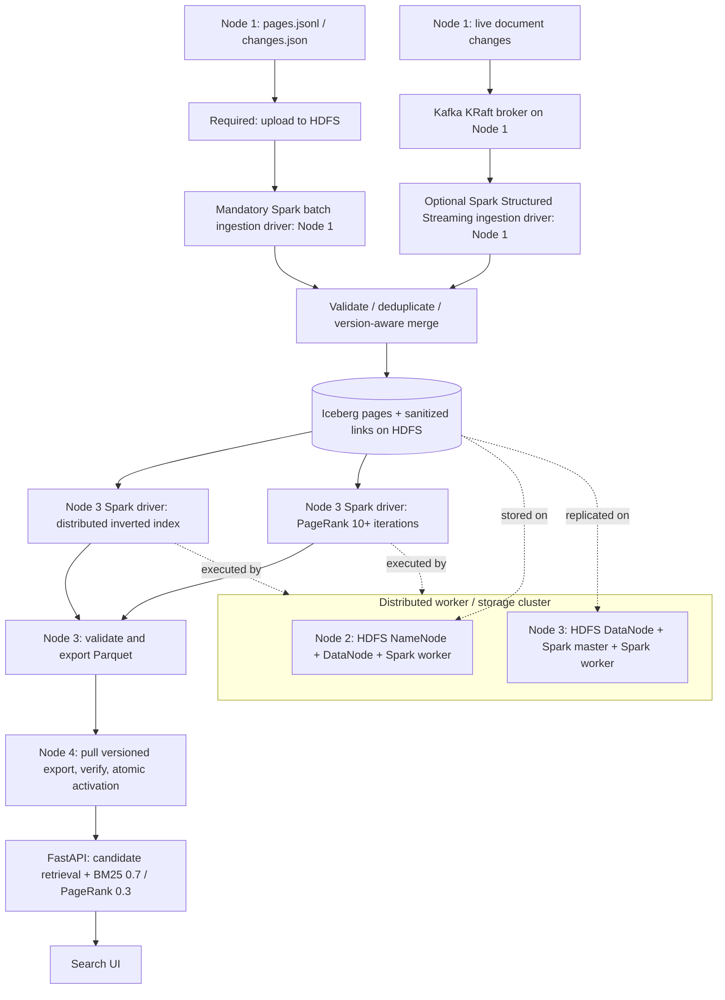

# ATLAS — Distributed Search Engine with Kafka

**Course:** PES University Big Data 2026 (UE24CS343AB2)  
**Architecture:** Four ZeroTier-connected Ubuntu VMs, HDFS replication **2**, distributed Spark, Iceberg versioned tables, BM25 + PageRank, FastAPI, optional Kafka events.

> **Status:** Implemented source-code starter with local unit tests **and offline checks against the uploaded official Phase 0/1 files**. NOT validated on a live four-VM cluster. Follow the cluster verification steps before claiming project completion. The Kafka stream is an additional path; mandatory Phase 0/Phase 1 still read JSONL from HDFS.

## Architecture



**Node responsibilities exactly match the manual:** Node 1 is an HDFS client and Spark ingestion driver (no Spark/HDFS daemons). Node 2 runs the HDFS NameNode, HDFS DataNode and Spark worker. Node 3 runs the Spark master, Spark worker, another HDFS DataNode, and indexing/PageRank/export drivers. Node 4 runs only FastAPI/UI and serves locally copied Parquet. An optional single-node Kafka KRaft broker can share Node 1 for classroom use.

## Requirements cross-check

| Course requirement | Implemented source | Verification |
|---|---|---|
| Phase 0/1 upload to HDFS | `scripts/run_phase_node1.sh`, `jobs/ingest.py` | `hdfs dfs -ls`, phase logs |
| Reject malformed and missing fields | `records.py`, `spark_common.py` | `scripts/check_input.py`, HDFS rejects |
| Highest-version deduplication / idempotent merge | `deduplicate`, `merge_documents` | replay same phase, compare snapshots |
| Drop broken document links | `rebuild_valid_links` Iceberg links table | query edge targets vs live pages |
| Iceberg snapshots/time travel/rollback | Hadoop Iceberg catalog, snapshots, `rebuild_links.py` | snapshot SQL + rollback demo |
| 2 DataNodes, HDFS replication 2 | `infra/hadoop` templates | `hdfs dfsadmin -report`, `fsck` |
| Distributed inverted index | `jobs/build_index.py` | inspect Iceberg `inverted_index` |
| PageRank ≥10 iterations, damping 0.85 | `jobs/build_index.py` | iterations in logs, score sum 1 |
| BM25 k1=1.2, b=0.75, weights 0.7/0.3 | `search_engine/ranking.py` | `tests/test_ranking.py`, API output |
| Versioned Parquet, validated activation | `jobs/export.py`, `search_engine/deploy.py` | deploy/rollback test |
| Node 4 FastAPI + frontend | `search_engine/api.py`, `frontend/` | `/api/search`, `/api/health` |
| Spark fault tolerance | Spark retries + HDFS copies, recovery procedure | `docs/failure_experiments.md` (must run) |
| Kafka enhancement | `producer.py`, `jobs/stream_ingest.py` | broker/replay exercise (must run) |

## Before setup: use the **official** guides

All course-specific tool setup guides are linked in [docs/course_commands.md](docs/course_commands.md). In particular, use **Ubuntu 24.04, Java 11, Hadoop 3.3.6, your course's Spark 3.5-compatible build**, and the official ZeroTier setup. The sample course Hadoop guide configures a **single-node HDFS replication factor of 1**; for this project change to **2 DataNodes and replication 2** as the project manual requires. Never format a NameNode that already contains project data.

### 0) Configure all VMs

On **all four machines**, clone this repo to the same location, then (with the actual host addresses):

```bash
cp .env.example .env
nano .env  # replace the placeholder NODE1..NODE4 ZeroTier addresses
set -a; source .env; set +a
```

For Node 1, 2 and 3, install/configure Java 11, Hadoop and Spark as specified in the [course guides](docs/course_commands.md). For Node 4, Python 3.11+ is enough. Set matching `core-site.xml` and `hdfs-site.xml` across Hadoop clients and daemons. Use `infra/hadoop/*.template` to adapt the single-node course configuration (replace `NODE2_ZEROTIER_IP`, `USER`). Use Spark standalone, not YARN, for the four-node master/worker layout.

**Cluster bootstrap (commands to run once, manually):**

```bash
# Node 2, after configuring HDFS and SSH and creating storage directories:
# FORMAT ONLY ON A FRESH EMPTY CLUSTER — never repeat on an existing cluster.
hdfs namenode -format
# Ensure $HADOOP_HOME/etc/hadoop/workers lists Node 2 + Node 3.
start-dfs.sh
jps                              # NameNode + DataNode on Node 2
hdfs dfsadmin -report             # should report two live DataNodes
hdfs getconf -confKey dfs.replication  # should print 2

# Node 3, after Spark standalone setup:
$SPARK_HOME/sbin/start-master.sh --host "$NODE3_HOST"
$SPARK_HOME/sbin/start-worker.sh "spark://${NODE3_HOST}:7077"

# Node 2, after Spark standalone setup:
$SPARK_HOME/sbin/start-worker.sh "spark://${NODE3_HOST}:7077"

# Node 1 verifies both remote services and creates HDFS directories:
hdfs dfs -mkdir -p /search/{input,rejects,exports,checkpoints,warehouse}
hdfs dfsadmin -report
curl "http://${NODE3_HOST}:8080/"  # Spark master UI should list 2 workers
```

Use **passwordless SSH** (private key under your own user; no keys committed) between the VMs for Hadoop control and release transfer. For Spark client mode, workers must reach the ingestion driver on Node 1 over ZeroTier (see `spark.driver.host` in `scripts/submit.sh`). Permit required ports **only on your private ZeroTier network**: HDFS 9000, Spark master 7077, Spark worker/driver ports, Kafka 9092, and relevant UI/SSH ports. Spark UI defaults can vary; never expose HDFS/Kafka/Spark openly on the internet.

**Check installed Spark/Scala versions** before first submit: `spark-submit --version`. The defaults in `.env.example` target Spark 3.5.x / Scala 2.12; change `ICEBERG_RUNTIME` and `SPARK_KAFKA_PACKAGE` to match the exact build. Spark 4 or different Scala binaries need other connector artifacts. Run `bash scripts/build_pyfiles.sh` automatically with the phase/index scripts to distribute the project's Python code to workers.

### 1) Mandatory Phase 0 — Node 1 then Node 3 then Node 4

The **actual Phase 0 and Phase 1 datasets have now been provided and validated offline**. They are bundled in the downloadable archive under `data/official/pages.jsonl` and `data/official/changes.json`. The `.json` suffix on Phase 1 is **misleading**: `changes.json` is **newline-delimited JSON**, not a JSON array. Use Spark `read.text()` as in `jobs/ingest.py`, not `spark.read.json(..., multiLine=True)`. The exact original files are in `data/official/` but **gitignored** by default (see `data/README.md` for why). The smaller `fixtures/` files are synthetic unit-test inputs, not course data. If you want to download independently, use the [course dataset folder](https://drive.google.com/drive/folders/11-ccp7-fLrSUqIRmDb3vZByNkJiXIOSK?usp=sharing).

### Dataset-specific results already verified OFFLINE

| Expected check | Phase 0 | After Phase 1 |
|---|---:|---:|
| Input lines | 1,040 | 100 new change lines |
| Valid JSON records | 1,020 | 100 |
| Malformed JSON rejected | 20 | 0 |
| Duplicate records removed | 20 | 0 |
| Live documents after merge | **1,000** | **975** |
| Valid links to surviving documents | **499** | **467** |
| Tombstones | 0 | **50** |

Phase 1 includes **50 DELETE operations** and **50 UPSERT operations** (25 updates to existing pages and 25 new pages). Iceberg `pages` will have **1,025 total rows including 50 tombstones** after Phase 1. These are offline reference expectations, not yet observed from your Spark cluster.

Run the offline verifier (bundled input):

```bash
PYTHONPATH=. python3 scripts/verify_official_dataset.py \
  data/official/pages.jsonl data/official/changes.json --output data/expected_results.json
```

The detailed expected outcomes, file hashes, and corresponding Spark checks are in [docs/DATASET_VALIDATION.md](docs/DATASET_VALIDATION.md).

Before running a distributed job, inspect the real schema:

```bash
# Node 1
set -a; source .env; set +a
PYTHONPATH=. python3 scripts/check_input.py data/official/pages.jsonl --phase 0
PYTHONPATH=. python3 scripts/check_input.py data/official/changes.json --phase 1
```

The supplied data field names have been verified (`doc_id`, `url`, `title`, `text`, `links`, and Phase 1 `op`). **20 intentionally malformed JSON lines in Phase 0 must be rejected**, and deletion tombstones without title/text must be accepted. For any future dataset with different field names, inspect the `keys` output and update aliases in `search_engine/records.py`. Supported aliases include `id`, `doc_id`, `page_id`; `text`, `content`, `body`; `links`, `out_links`, `outlinks`; numeric `version` or `revision`; and delete tombstones.

```bash
# Node 1 (Spark client, no Spark/HDFS daemons)
bash scripts/run_phase_node1.sh 0 data/official/pages.jsonl

# Node 3 (separate terminal, after Phase 0 ingestion succeeds)
set -a; source .env; set +a
bash scripts/verify_phase_node3.sh 0  # should pass 1,000 live docs and 499 links
bash scripts/run_index_node3.sh v1

# Node 4 (after the v1 export is ready)
set -a; source .env; set +a
python3 -m venv .venv && source .venv/bin/activate
pip install -r requirements.txt
# Ensure writable SERVING_ROOT, e.g. mkdir -p "$HOME/search-serving" and change .env
bash scripts/deploy_from_node3.sh v1
SERVING_ROOT="$SERVING_ROOT" uvicorn search_engine.api:app --host 0.0.0.0 --port 8000

# From your browser: http://NODE4_ZEROTIER_IP:8000
# API:          http://NODE4_ZEROTIER_IP:8000/api/health
# Search:       http://NODE4_ZEROTIER_IP:8000/api/search?q=planet
```

**Important:** Choose a writable `SERVING_ROOT` on Node 4 (e.g. `$HOME/search-serving`) rather than `/srv/distributed-search` unless you explicitly provision permissions. All four nodes should use the same configuration values where applicable. Node 4's deployment script uses SSH to Node 3 to fetch the HDFS export into a local staging folder and pulls it across with `rsync`. `rsync` must be installed on Nodes 3 and 4.

### 2) Mandatory Phase 1 — after seeing v1 search results

```bash
# Node 1
bash scripts/run_phase_node1.sh 1 data/official/changes.json
# Node 3
bash scripts/verify_phase_node3.sh 1  # should pass 975 live docs and 467 links
bash scripts/run_index_node3.sh v2
# Node 4
bash scripts/deploy_from_node3.sh v2
# API now reports v2, old v1 remains available for rollback.
```

Re-ingest Phase 0 or Phase 1 to verify no document changes or unnecessary `pages` snapshot were created (unchanged documents are intentionally skipped). Check the latest Iceberg snapshot ID and compare before/after. The links table is an atomic, derived sanitized edge table; the raw source links in `pages.raw_links` are deliberately preserved for re-resolution as new target pages appear.

### 3) Optional Kafka update stream

Run only **after** the mandatory batch demo works. Broker is single-node **KRaft** on Node 1 and not HA; Kafka is additional, NOT a replacement for the HDFS `pages.jsonl`/`changes.json` inputs.

1. Install the version of Kafka from the [course Kafka KRaft guide](https://big-data-2026-supersite.super.site/kafka-kraft). Adapt `infra/kafka/server.properties.template` (node IP, `USER`, log directory).
2. On Node 1 **once on a new broker**, use `$KAFKA_HOME/bin/kafka-storage.sh random-uuid` and `$KAFKA_HOME/bin/kafka-storage.sh format -t <ID> -c <config>`. Never format an existing Kafka log directory.
3. Start it with `$KAFKA_HOME/bin/kafka-server-start.sh <config>`.
4. Create a topic (on Node 1):

```bash
$KAFKA_HOME/bin/kafka-topics.sh --bootstrap-server "$KAFKA_BOOTSTRAP" \
  --create --if-not-exists --topic document_updates --partitions 2 --replication-factor 1
$KAFKA_HOME/bin/kafka-topics.sh --bootstrap-server "$KAFKA_BOOTSTRAP" --describe --topic document_updates
```

Start the Spark Structured Streaming consumer on Node 1:

```bash
set -a; source .env; set +a
bash scripts/run_stream_node1.sh
```

In a **second terminal** on Node 1, publish *new versioned changes* (not already ingested through the mandatory Phase 0/1 pipeline):

```bash
python3 -m venv .venv && source .venv/bin/activate
pip install -r requirements-ingestion.txt
PYTHONPATH=. python -m search_engine.producer \
  --bootstrap "$KAFKA_BOOTSTRAP" --input /path/to/new_document_events.jsonl
```

The stream micro-batches events into Iceberg; HDFS checkpoints store Kafka offsets. `merge_documents` is idempotent for duplicate events and uses highest-version-wins rules. **No automatic index refresh is claimed:** to publish a new version reliably, stop/pause the streaming writer, run `run_index_node3.sh v3` on Node 3, then `deploy_from_node3.sh v3` on Node 4. This serializes Iceberg writes and produces a consistent new snapshot. A production coordinator/transactional orchestration layer is an optional future enhancement.

### 4) Tests and fault tolerance

Local/source-only checks:

```bash
python3 -m pip install pytest
PYTHONPATH=. python3 -m pytest -q tests/
python3 -m compileall -q jobs search_engine scripts
PYTHONPATH=. python3 scripts/check_input.py fixtures/pages.jsonl
```

Actual cluster verification **still required**: see [docs/failure_experiments.md](docs/failure_experiments.md) and [docs/verification_checklist.md](docs/verification_checklist.md). Minimum verification covers HDFS replication, both Spark workers, Iceberg idempotence/snapshots/time travel, PageRank mass conservation, BM25 result ordering, v1/v2 result differences, failed export retaining v1, replay, and Spark worker failure recovery. This source package has **not** run those tests remotely.

### 5) Rollback / snapshot history

```sql
-- Submit from an Iceberg-enabled Spark SQL session on Node 3.
SELECT snapshot_id, committed_at, operation FROM lake.search.pages.snapshots
ORDER BY committed_at DESC;
SELECT * FROM lake.search.pages VERSION AS OF 1234567890123456789;
-- Only when intentionally rolling pages back (replace with real ID):
CALL lake.system.rollback_to_snapshot('search.pages', 1234567890123456789);
```

After rolling back the `pages` table, rebuild sanitized links with `scripts/submit.sh jobs/rebuild_links.py` on Node 3, rerun indexing/export to a **new version** and deploy that export. For a fast user-visible rollback to an existing known-good Parquet release, run `scripts/rollback_node4.sh v1` **on Node 4** — this does not roll back Iceberg; it changes serving version only. Do not confuse the two rollback types.

## Repository layout

```text
jobs/              Phase ingestion, Kafka streaming, PageRank/inverted index, export, cluster verifier
search_engine/     Canonical parser, Spark/Iceberg utilities, ranking, API, deployment
frontend/          Search interface (static HTML/CSS/JS)
scripts/           VM-specific run/deploy/check/verification commands
infra/             Config templates; replace ZeroTier IPs, do not copy blindly
fixtures/          Synthetic data ONLY; never submit as official result
data/              Uploaded official data (bundled; gitignored) and dataset notes
tests/             Offline parser/ranking/atomic switch unit tests
docs/              Course guide references, validation, failure experiments
.github/workflows/ Unit CI (does not deploy or run HDFS/Spark)
```

## Important limitations / design decisions

- The **official uploaded data schema has been inspected and the offline phase/replay checks pass**. The actual four-VM Spark/Hadoop/Kafka environment is still inaccessible; complete the real distributed acceptance checks before claiming a finished deployment.
- This pipeline rebuilds the full inverted index and PageRank after each batch. For a ~1,000-page academic corpus this is a reliable first implementation; **true incremental index maintenance is not implemented**.
- Kafka processing is **at least once**, with deterministic version-aware upserts for retry safety, not a claim of end-to-end exactly-once across Kafka/Iceberg/export.
- Single Node 1 Kafka broker and single Node 2 HDFS NameNode are single points of failure; HDFS DataNode replication is not the same as NameNode HA.
- Running Kafka stream updates and mandatory batch writes simultaneously is **not supported** by this simple orchestrated version. Stop the stream before Phase 0/1 or a consistent reindex/export.
- `localhost` HDFS defaults from a single-node tutorial will **not** work across these four VMs; use Node 2's ZeroTier address. Default `dfs.replication=1` from the single-node lab must be changed to **2**.
- For document URLs, the provided link references must map to existing doc IDs or page URLs; unsupported schemas must be mapped explicitly.
- No performance/latency/scale claim is made until measured on the actual course machines and dataset.

## References

- [Official project specification](https://big-data-2026-supersite.super.site/projects-1/distributed-search-engine)
- [Course homepage and hands-on tutorials](https://big-data-2026-supersite.super.site/)
- [Spark SQL Structured Streaming guide](https://big-data-2026-supersite.super.site/spark-structured-streaming-a-quick-starter)
- [Apache Iceberg hands-on](https://big-data-2026-supersite.super.site/apache-iceberg-hands-on)
